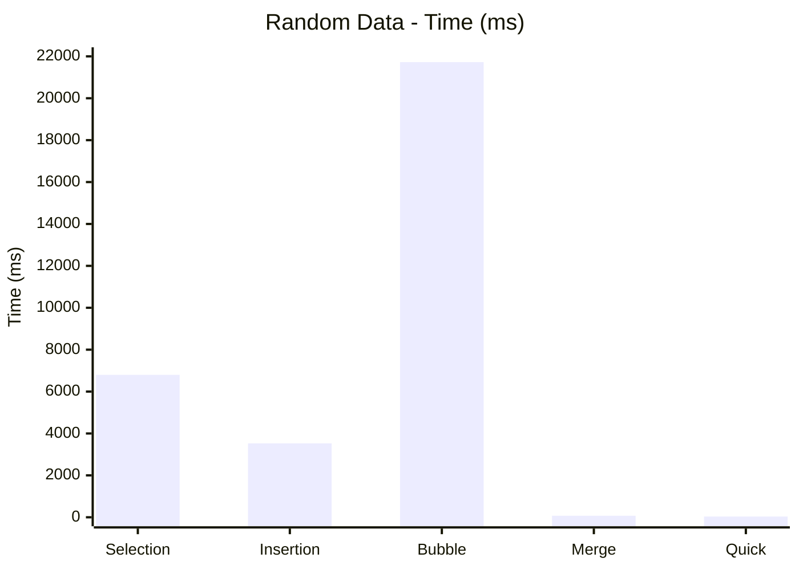
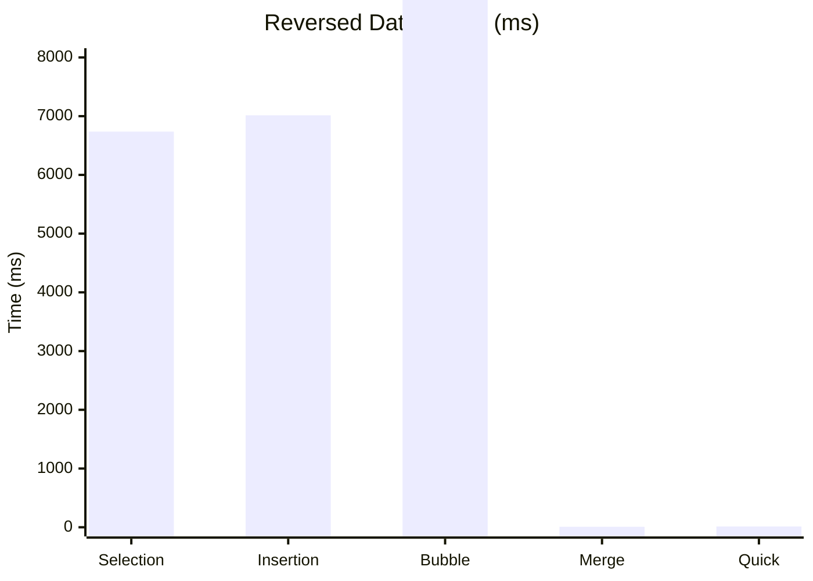
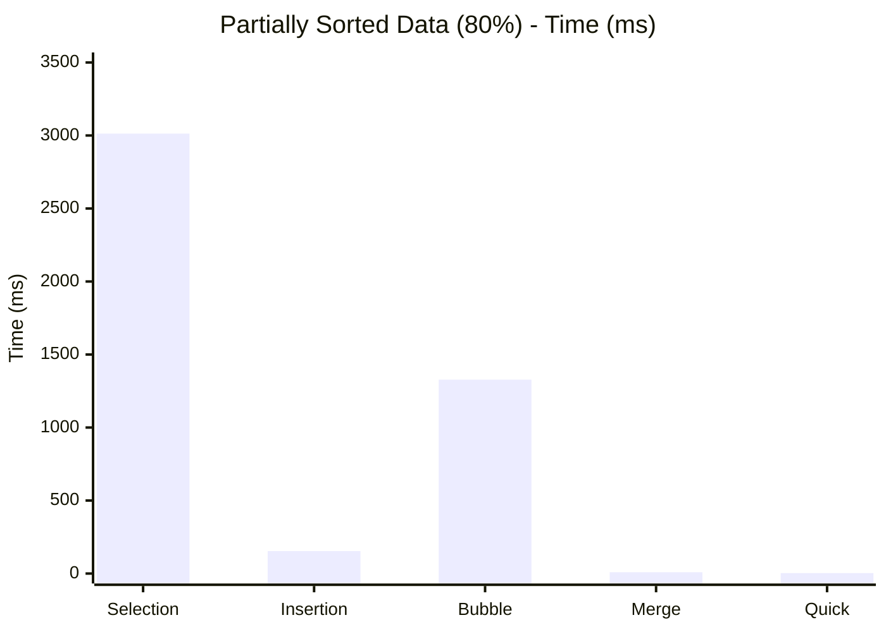
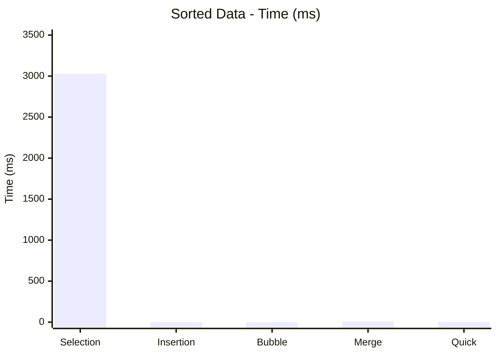
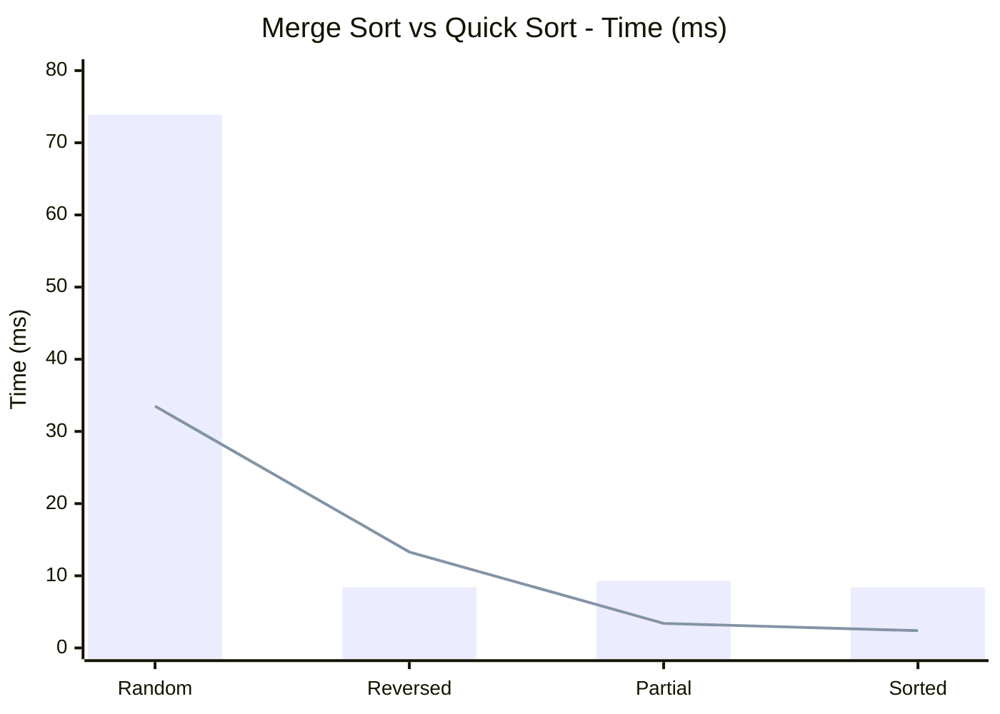

# ⏱️ تحليل ومقارنة أداء خوارزميات الترتيب

مشروع أكاديمي ضمن مادة **تراكيب بيانات 2  يهدف إلى دراسة ومقارنة الأداء العملي لخمس من أشهر خوارزميات الترتيب باستخدام لغة **Java**.

---

## 📋 بيانات الطالب

| البند | القيمة |
| :--- | :--- |
| **اسم الطالب** | رواد محمد البوعيشي |
| **رقم القيد** | 3169061 |
| **رقم الشعبة** | B |

---

## 🔍 وصف المشروع

يقوم البرنامج بتوليد واختبار مصفوفة تحتوي على **100,000 عنصر** عبر أربع حالات مختلفة لترتيب البيانات، وقياس زمن التنفيذ الفعلي لكل خوارزمية بدقة بالميكروثانية (µs).

### الخوارزميات المختبرة
| # | الخوارزمية | الفكرة المختصرة |
| :-: | :--- | :--- |
| 1 | **Selection Sort** | اختيار أصغر عنصر في كل دورة ووضعه في مكانه الصحيح |
| 2 | **Insertion Sort** | إدراج كل عنصر في موضعه المناسب داخل الجزء المرتب |
| 3 | **Bubble Sort** | مقارنة العناصر المتجاورة وتبديلها، مع **التوقف المبكر** عند عدم حدوث تبديل |
| 4 | **Merge Sort** | تقسيم المصفوفة ثم ترتيب الأجزاء ودمجها (Divide & Conquer) |
| 5 | **Quick Sort** | اختيار محور (Pivot) وتقسيم المصفوفة حوله (Divide & Conquer) |

### حالات اختبار البيانات
| الحالة | الوصف |
| :--- | :--- |
| 🎲 **عشوائية (Random)** | بيانات موزعة بشكل عشوائي تام |
| 🔃 **عكسية (Reversed)** | بيانات مرتبة تنازلياً |
| 🌗 **مرتبة جزئياً (Partially Sorted)** | بيانات مرتبة بنسبة 80% |
| ✅ **مرتبة بالكامل (Sorted)** | بيانات مرتبة تصاعدياً |

---

## 📐 التعقيد الزمني النظري

| الخوارزمية | أفضل حالة | الحالة المتوسطة | أسوأ حالة | المساحة الإضافية | مستقرة (Stable) |
| :--- | :---: | :---: | :---: | :---: | :---: |
| **Selection Sort** | O(n²) | O(n²) | O(n²) | O(1) | ❌ |
| **Insertion Sort** | O(n) | O(n²) | O(n²) | O(1) | ✅ |
| **Bubble Sort** (مع التوقف المبكر) | O(n) | O(n²) | O(n²) | O(1) | ✅ |
| **Merge Sort** | O(n log n) | O(n log n) | O(n log n) | O(n) | ✅ |
| **Quick Sort** | O(n log n) | O(n log n) | O(n²) | O(log n) | ❌ |

---

## 📊 نتائج الاختبارات

### الأزمنة بالميكروثانية (µs)

| الخوارزمية | عشوائية (Random) | عكسية (Reversed) | مرتبة جزئياً (80%) | مرتبة بالكامل (Sorted) |
| :--- | :---: | :---: | :---: | :---: |
| **Selection Sort** | 6,800,454 | 6,737,159 | 3,013,129 | 3,030,391 |
| **Insertion Sort** | 3,527,565 | 7,015,417 | 153,631 | 491 |
| **Bubble Sort** | 21,726,410 | 9,998,005 | 1,328,423 | **51** |
| **Merge Sort** | 73,900 | **8,382** | 9,281 | 8,419 |
| **Quick Sort** | **33,515** | 13,342 | **3,448** | 2,382 |

> 🏆 الخط العريض يشير إلى **أسرع خوارزمية** في كل حالة.

### الأزمنة بالميلي ثانية (ms) — لسهولة القراءة

| الخوارزمية | عشوائية | عكسية | مرتبة جزئياً | مرتبة بالكامل |
| :--- | :---: | :---: | :---: | :---: |
| **Selection Sort** | 6,800.45 | 6,737.16 | 3,013.13 | 3,030.39 |
| **Insertion Sort** | 3,527.57 | 7,015.42 | 153.63 | 0.49 |
| **Bubble Sort** | 21,726.41 | 9,998.01 | 1,328.42 | 0.05 |
| **Merge Sort** | 73.90 | 8.38 | 9.28 | 8.42 |
| **Quick Sort** | 33.52 | 13.34 | 3.45 | 2.38 |

---

## 📈 الرسوم البيانية

> الأزمنة في الرسوم التالية بالميلي ثانية (ms). كلما كان العمود أقصر كان الأداء أفضل.

### 1) البيانات العشوائية (Random)

### 2) البيانات العكسية (Reversed)

### 3) البيانات المرتبة جزئياً (80%)

### 4) البيانات المرتبة بالكامل (Sorted)

### 5) مقارنة خوارزميتي O(n log n): Merge Sort مقابل Quick Sort

> العمود = **Merge Sort** ، الخط = **Quick Sort**.

---

## 🧮 جداول المقارنة والتحليل

### أ) أسرع وأبطأ خوارزمية في كل حالة

| حالة البيانات | 🥇 الأسرع | الزمن (µs) | 🐢 الأبطأ | الزمن (µs) |
| :--- | :--- | :---: | :--- | :---: |
| عشوائية | Quick Sort | 33,515 | Bubble Sort | 21,726,410 |
| عكسية | Merge Sort | 8,382 | Bubble Sort | 9,998,005 |
| مرتبة جزئياً (80%) | Quick Sort | 3,448 | Selection Sort | 3,013,129 |
| مرتبة بالكامل | Bubble Sort | 51 | Selection Sort | 3,030,391 |

### ب) ترتيب الخوارزميات في حالة البيانات المرتبة بالكامل

| الترتيب | الخوارزمية | الزمن (µs) |
| :-: | :--- | :---: |
| 1 | Bubble Sort | 51 |
| 2 | Insertion Sort | 491 |
| 3 | Quick Sort | 2,382 |
| 4 | Merge Sort | 8,419 |
| 5 | Selection Sort | 3,030,391 |

### ج) مدى تفوق Quick Sort في حالة البيانات العشوائية

| مقارنة | عدد مرات التسارع (تقريباً) |
| :--- | :---: |
| Quick Sort مقابل Bubble Sort | ≈ 648 × |
| Quick Sort مقابل Selection Sort | ≈ 203 × |
| Quick Sort مقابل Insertion Sort | ≈ 105 × |
| Quick Sort مقابل Merge Sort | ≈ 2.2 × |

### د) تأثير حالة البيانات على كل خوارزمية (أبطأ حالة ÷ أسرع حالة)

| الخوارزمية | أسرع حالة (µs) | أبطأ حالة (µs) | مدى التغير | حساسية لترتيب البيانات |
| :--- | :---: | :---: | :---: | :---: |
| **Selection Sort** | 3,013,129 | 6,800,454 | ≈ 2.3 × | منخفضة |
| **Insertion Sort** | 491 | 7,015,417 | ≈ 14,000 × | عالية جداً |
| **Bubble Sort** | 51 | 21,726,410 | ≈ 426,000 × | عالية جداً |
| **Merge Sort** | 8,382 | 73,900 | ≈ 8.8 × | منخفضة |
| **Quick Sort** | 2,382 | 33,515 | ≈ 14 × | متوسطة |

## ⚙️ طريقة تشغيل المشروع

1. فتح بيئة التطوير **NetBeans** أو أي محرر يدعم لغة Java.
2. إنشاء مشروع جديد وإضافة ملف `SortingComparison.java`.
3. تشغيل الملف (`Run File`).
4. مراجعة النتائج والأزمنة المسجلة في نافذة `Console`.

---
 
